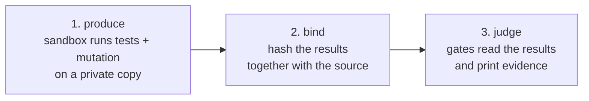

# gauntlet

[](https://github.com/gajeshbhat/gauntlet/actions/workflows/ci.yml)
[](LICENSE)

**Don't read the code an AI agent wrote. Make it run a gauntlet, and read the evidence.**

An agent can write code faster than anyone can review it. gauntlet runs your Python project's tests in a sandbox,
measures how good those tests really are, and fails when the code is not proven: too complex for its tests, bugs
planted in it that the tests miss, or code hidden from the checks.

## What it checks

| Check | In plain words |
|---|---|
| **CRAP score** | A function that is complicated *and* barely tested is risky. Score = complexity² × (1 − coverage)³ + complexity. Limit: 8. |
| **Mutation testing** | gauntlet makes tiny deliberate bugs (`<` becomes `<=`) and reruns your tests. If they still pass, they run the code without checking it. Limit: 90% of bugs caught. |
| **No hiding** | Caps `# pragma: no cover`, refuses config that hides files from coverage, and fails when a check examined nothing. |
| **Layers** (optional) | Imports may only point inward, as you declare. |
| **Spec** (optional) | A Gherkin spec you approve first; every scenario must point at a real test. |

Your limits live in a policy file outside the repository, so an agent cannot loosen them by editing the repo.

## Quickstart

You need `git`, [`uv`](https://docs.astral.sh/uv/) and a sandbox: Docker or Podman, or
[Workshop](https://snapcraft.io/workshop) on Linux.

```sh
uv tool install "gauntlet-core[python] @ git+https://github.com/gajeshbhat/gauntlet@v0.1.0#subdirectory=packages/gauntlet-core"
cd your-project                        # a git repository
gauntlet init .                        # detect the project, write gauntlet.toml
gauntlet run . --report EVIDENCE.md    # exit 0: every gate passed
```

A failing run says exactly what to fix:

```
src/app/parse.py:12: parse CRAP 17.8 > 8 (complexity 5, coverage 20%)
clean: 41 function(s) checked, 1 over CRAP 8
mutation score 84.0% < 90%
```

Exit codes: `0` passed, `1` a gate failed, `2` error or bad input. In Claude Code, install the plugin with
`/plugin install gauntlet --marketplace gajeshbhat/gauntlet` and run `/gauntlet`.

## How it works



Project code only ever runs inside the sandbox. The gates read results and refuse any that do not match the source.
Details: [architecture](docs/architecture.md), [security model](SECURITY.md).

## Limits

- Python only, for now. The first run of a large project can take a long time: mutation testing reruns the tests once
  per bug it plants.
- Projects that need services or system libraries may need setup. When a project's own tests fail in the sandbox,
  gauntlet stops with a clear error instead of reporting a wrong number.
- Tests inside the sandbox could forge their own numbers. The sandbox protects your machine, not the numbers.

## Documentation

[Tutorial](docs/tutorial.md) · [How-to guides](docs/how-to.md) · [Reference](docs/reference.md) ·
[Explanation](docs/explanation.md) · [Architecture](docs/architecture.md) · [Contributing](CONTRIBUTING.md)

## Credits

The idea comes from Robert C. Martin: surround the agent with strict constraints and make its work run a gauntlet,
instead of reading its code. He describes it in an [interview with Matt Pocock](https://youtu.be/zcLPGC-tvgk) and in
[this post](https://x.com/unclebobmartin/status/2080257779395154409).

[old-coder](https://github.com/amazingang/old-coder) by AmazingAng applies the same idea as an agent skill. gauntlet
borrows some of its ideas (a spec a person approves first, gates that fail closed, negative controls, an evidence
report) but none of its code or text.

## License

[MIT](LICENSE). Copyright © 2026 Gajesh Bhat.
