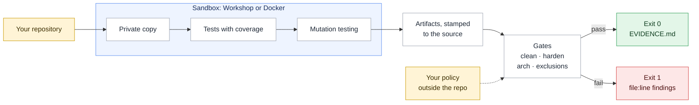

# gauntlet

**Don't read the code an AI agent wrote. Make it run a gauntlet, and read the evidence.**

gauntlet runs tests, coverage and mutation testing in a sandbox, then fails loudly when code is too complex for its
tests, when tests let planted bugs survive, or when code is hidden from the checks. It works on Python, Go,
JavaScript/TypeScript, C#, Java, Rust, C/C++ and Dart projects, with no code changes.

```sh
uv tool install git+https://github.com/gajeshbhat/gauntlet
cd your-project
gauntlet init .
gauntlet run . --report EVIDENCE.md
```



`run` needs [Canonical Workshop](https://snapcraft.io/workshop) or Docker. In Claude Code 2.1.275 or later:
`/plugin install gauntlet --marketplace gajeshbhat/gauntlet`, then `/gauntlet`.

## Documentation

- [Tutorial](docs/tutorial.md): your first gauntlet run, start to finish.
- [How-to guides](docs/how-to.md): CI, the agent loop, your own toolchain, Docker, policies.
- [Reference](docs/reference.md): commands, exit codes, gates, languages, `gauntlet.toml`, `policy.toml`.
- [Explanation](docs/explanation.md): why the gates fail closed, and how results are bound to the source.
- [Security model](SECURITY.md): what gauntlet does and does not protect against.

## Develop

```sh
./check.sh     # ruff, pyright (strict), pytest at 100% branch coverage, then gauntlet checks itself
```

[MIT](LICENSE). The idea is Robert C. Martin's; see [credits](docs/explanation.md#credits).
