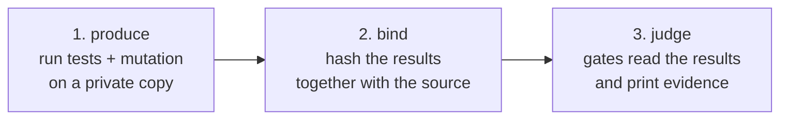

# gauntlet

[](https://github.com/gajeshbhat/gauntlet/actions/workflows/ci.yml)
[](LICENSE)

**Don't read the code an AI agent wrote. Make it run a gauntlet, and read the evidence.**

An agent can write code faster than anyone can review it. gauntlet runs your Python project's tests,
measures how good those tests really are, and fails when the code is not proven: too complex for its tests, bugs
planted in it that the tests miss, or code hidden from the checks.

## Use it in Claude Code

Needs Claude Code 2.1.275 or later.

```
/plugin install gauntlet --marketplace gajeshbhat/gauntlet
/gauntlet run
```

Claude installs the CLI if it is missing, runs the gates, reads the evidence and fixes the cause (it is told never to
add ignore comments or loosen a limit).

## Use it from the terminal

You need `git` and [`uv`](https://docs.astral.sh/uv/). Your tests run on this machine, in a private copy of the
repo; for isolation, see [Run in an OpenShell sandbox](docs/how-to.md#run-in-an-openshell-sandbox).

```sh
REPO=git+https://github.com/gajeshbhat/gauntlet@v0.2.0
uv tool install \
  "gauntlet-core[python] @ $REPO#subdirectory=packages/gauntlet-core"
```

Then, inside a git repository:

```sh
gauntlet init .                      # write gauntlet.toml
gauntlet run . --report EVIDENCE.md  # exit 0: every gate passed
gauntlet run . --changed main        # later: only the code that differs from main
```

A failing run says exactly what to fix:

```
src/app/parse.py:12: parse CRAP 17.8 > 8 (complexity 5, coverage 20%)
clean: 41 function(s) checked, 1 over CRAP 8
src/app/grade.py:9: app.grade.x_grade__mutmut_5: survived [if score >= 80: -> if score > 80:]
mutation score 84.0% < 90%
```

The third line is a planted bug no test noticed: the function it is in, and the line it changed.

Exit codes: `0` passed, `1` a gate failed, `2` error or bad input.

## What it checks

| Check | In plain words |
|---|---|
| **CRAP score** | A function that is complicated *and* barely tested is risky. Score = complexity² × (1 − coverage)³ + complexity. Limit: 8. |
| **Mutation testing** | gauntlet plants tiny bugs (`<` becomes `<=`) and reruns your tests. If they still pass, they run the code without checking it. Limit: 90% of bugs caught. |
| **No hiding** | Caps `# pragma: no cover`, refuses config that hides files from coverage, and fails when a check examined nothing. |
| **Layers** (optional) | Imports may only point inward, as you declare. |
| **Spec** (optional) | A Gherkin spec you approve first; every scenario must point at a real test. |

Your limits live in a policy file outside the repository, so an agent cannot loosen them by editing the repo.

## Core and plugin

gauntlet is split so the checks never depend on a language.

| | Language-agnostic core | Language plugin |
|---|---|---|
| **Package** | `gauntlet-core` | `gauntlet-python` |
| **Knows** | The gates, the CLI, the trust model | How to run a language's tests, read its coverage and mutation results, and list its imports and comments |
| **Does not know** | Any language | The gates or the CLI |
| **Python today** | CRAP score, limits, layers, specs, evidence report | `pytest` + `coverage.py` + `mutmut` |

A plugin is one small value that core finds through an entry point, so adding a language means writing a plugin and
changing nothing in core. See [Write a language plugin](docs/how-to.md) and the [architecture](docs/architecture.md).

## How it works



Project code runs only in step 1, in a throwaway copy of the repo: on this machine by default, or in an OpenShell
sandbox if you ask. The gates read results and refuse any that do not match the source. More in the
[security model](SECURITY.md).

## Limits

- Python only, for now. A full run of a large project can take a long time: mutation testing reruns the tests once
  per bug it plants. `--changed` plants bugs only in the files you touched.
- Projects that need services or system libraries may need setup. When a project's own tests fail,
  gauntlet stops with a clear error instead of reporting a wrong number.
- Tests could forge their own numbers. A sandbox protects your machine, not the numbers.

## Documentation

[Tutorial](docs/tutorial.md) · [How-to guides](docs/how-to.md) · [Reference](docs/reference.md) ·
[Explanation](docs/explanation.md) · [Architecture](docs/architecture.md) · [Contributing](CONTRIBUTING.md)

## Credits

The idea comes from Robert C. Martin: surround the agent with strict constraints and make its work run a gauntlet,
instead of reading its code. He describes it in an [interview with Matt Pocock](https://youtu.be/zcLPGC-tvgk) and in
[this post](https://x.com/unclebobmartin/status/2080257779395154409).

[old-coder](https://github.com/amazingang/old-coder) by AmazingAng applies the same idea as an agent skill. gauntlet
borrows some of its ideas (a spec a person approves first, gates that fail closed, negative controls, an evidence
report) but none of its code or text.

## License

[MIT](LICENSE). Copyright © 2026 Gajesh Bhat.
