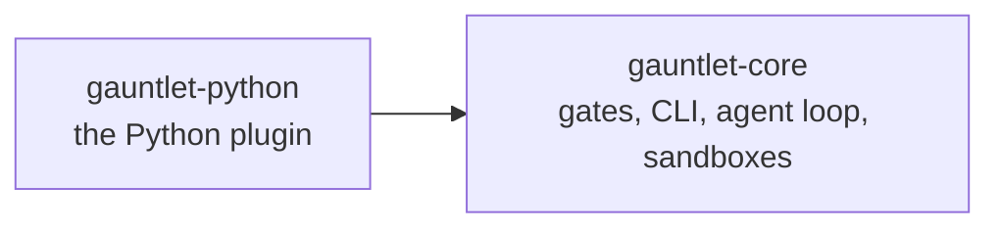
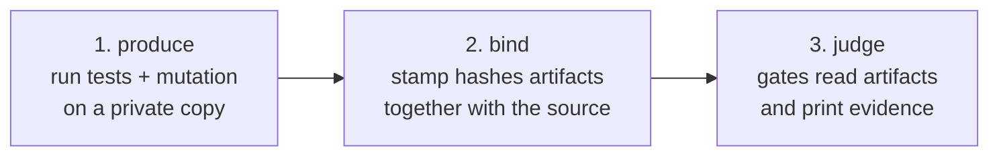
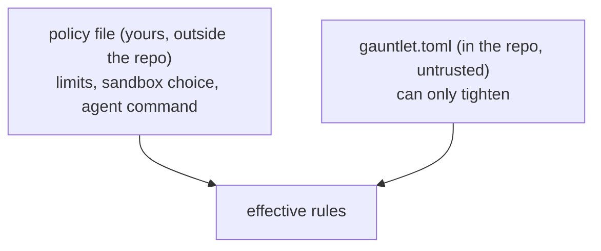

# Architecture

gauntlet judges code by evidence instead of by reading it. It runs a project's tests and mutation tool on a private copy,
keeps the results, and fails if the results are weak or were tampered with.

## Two packages

| Package | Module | Job |
|---|---|---|
| `gauntlet-core` | `gauntlet` | The gates, the CLI and the agent loop. Knows no language. |
| `gauntlet-python` | `gauntlet_python` | The only language plugin: pytest + coverage.py + mutmut. |

Core never imports the plugin. It finds it through the `gauntlet.languages` entry-point group. Dependencies point one
way, and `gauntlet.toml` in this repo enforces it with `[layers]` and `forbid` rules that gauntlet checks on itself.

## The one idea: produce, bind, judge

1. **Produce.** `runner.produce` copies the git-listed files into a private temp dir (`snapshot`), runs the plugin's
   fixed steps in a sandbox (`sandbox.py`: this machine by default), and collects the artifacts (`coverage.json`, `mutmut-results.txt`).
2. **Bind.** `provenance.stamp` writes `gauntlet-manifest.json`: a hash of HEAD plus every listed file, and a hash of
   each artifact. `verify` refuses artifacts that changed, or were made from different source.
3. **Judge.** The gates only read artifacts and source. They never run project code.

## Gates

| Gate | Reads | Fails when |
|---|---|---|
| `clean` | coverage | a function's CRAP score exceeds the limit (default 8); a source file missing from coverage counts as 0% |
| `harden` | mutation results | the mutation score is under the floor (default 90%); mutants that never ran count as survivors |
| `exclusions` | source + tool config | more than `max_exclusions` ignore comments, or coverage/mutation settings that hide files |
| `arch` | source imports | an import points at an outer layer, or breaks a `forbid` rule |
| `spec` | a Gherkin file | a scenario has no When/Then, or its `@test(path::name)` points at no real test |

Every gate fails closed: empty coverage, a scope that matches nothing, or no mutants exits 2.
`check` = arch + clean + exclusions. `run` = produce, then check + harden.

Exit codes: `0` all passed, `1` a gate failed, `2` error or bad input, `3` `loop` wrote a spec for you to approve.

## Whose rules win

- `policy.apply` rejects a repo config that loosens CRAP or mutation limits.
- `gauntlet pin` records the hash of `gauntlet.toml` in the policy; any later edit fails until you re-pin.
- `require_pin` and `require_arch` make an unpinned config, or a missing `[layers]`, an error.

## Trust boundaries

| Untrusted | How it is contained |
|---|---|
| Project code and tests | Run only in step 1, on a copy: on this machine with a scrubbed environment, or in an OpenShell sandbox. Gates never execute them. |
| Artifacts the run wrote | Size caps, symlink checks, the stale mutation report is deleted just before the mutation run, and stamping binds them to the source. |
| Repo config (`gauntlet.toml`, coverage settings) | Policy ratchet, pin, exclusion budget. |
| The agent | Works on a copy in an OpenShell sandbox (or on this machine, if the policy accepts that); its git dir lives beside the workspace (`<ws>.gauntlet-git`), outside the sandbox, so it cannot plant git filters. Output is a patch you apply. Edits to control files are flagged. |
| Git itself | Asked for names only, with a scrubbed environment; contents are hashed in Python. |

**Not defended:** tests can forge coverage or mutation numbers. A sandbox protects your machine, not the numbers. See [SECURITY.md](../SECURITY.md).

## The agent loop

`gauntlet loop` runs ephemeral agents (one fresh process each) on a copy, and requires `sandbox = "openshell"` unless
the policy sets `allow_unsandboxed_agent`:

1. **Specifier** writes `spec.feature` (Gherkin). gauntlet stops (exit 3) so you can approve it.
2. **Coder** implements the approved spec and writes the tagged tests.
3. Gates run. Failures go to a **Fixer** that sees only the failures, up to `max_rounds`.
4. You get `loop.patch` and `EVIDENCE.md`. Your working tree is never touched.

## Plugin contract

A language plugin is one `gauntlet.plugin.Language` value (`plugin.py`):

- **Data:** source suffixes, test-file regex, ignore-comment regex, coverage file name, OpenShell image.
- **Steps:** the fixed commands, built from the project and output directories. The Python plugin runs
  `pytest --cov`, `mutmut run`, then `mutmut results`.
- **Readers:** parse coverage and mutation output, list a file's imports and comments, find config-level excludes,
  and write a starter `gauntlet.toml`.

Register it as `[project.entry-points."gauntlet.languages"]` and install it next to `gauntlet-core`.

## Sandbox contract

A sandbox (`gauntlet.sandbox.Sandbox`) works on the snapshot and has `project_dir`, `ensure()`,
`exec(argv, env, timeout) -> ExecResult`, `fetch(subdir)` and `remove()`. Commands are argv lists; no shell sees them,
and a timeout is exit 124.

- **Local (default):** runs on this machine in the snapshot (a 0700 temp dir), with a minimal environment (`PATH`,
  `HOME`, proxy and certificate variables, `UV_*`, plus the step's own). No isolation; `run` prints a notice.
- **OpenShell (`sandbox = "openshell"`, optional):** a sandbox from the language's image. No network except the package
  index (and `agent_hosts` for the agent). It has no host mount, so `ensure` copies the snapshot in and `fetch` copies
  results back, as tar in small pieces. Needs `gauntlet-core[openshell]` and a gateway.

## Where to change things

| To add... | Touch |
|---|---|
| A gate | a function in `cli.py` returning `GateResult`, an entry in `GATES`, a module with the logic |
| A language | a new package exposing a `Language`; no core change |
| A sandbox | a class with the five members above, plus a case in `backends.py` |
| A policy key | `policy.py` (the `Policy` field and its validation) |

Each module has a docstring saying what it does; read `cli.py` first, it wires everything together.
