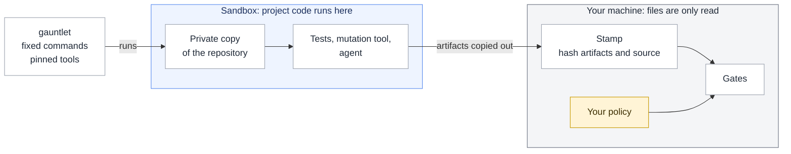

# Explanation

## Why run a gauntlet instead of reading the code

An agent writes code faster than a person can review it. Reading every line does not scale, and a plausible diff can
still be wrong. gauntlet turns review into evidence: code that is simple enough for its tests, tests that catch planted
bugs, layers that hold, and a spec you approved with a real test behind each scenario. You read the spec and the
evidence, not the implementation.

## Fail closed

A gate that checked nothing must never pass. Empty coverage, a `--only` that matches nothing, layers that match no
module, or no mutants in scope are errors (exit 2), not passes. A source file missing from the coverage report counts as
0% covered. A mutant that no test ran counts as survived. Where a language has no mutation tool, `run` fails unless you
accept that in your policy.

## Why CRAP

CRAP (Change Risk Anti-Patterns) combines complexity and coverage: complexity² × (1 − coverage)³ + complexity. A simple
function needs few tests; a complex one needs many. A fully covered function scores its complexity, so the default limit
of 8 also caps complexity. This is higher than the 4 or 5 often used for people, because agents handle more complexity.
Coverage alone is not enough, because tests can run code without checking it. Mutation testing closes that gap.

## Your rules live outside the repository

An agent that can edit the repository can edit its config. Your limits therefore live in your policy file outside the
repository. `gauntlet.toml` may tighten them, never weaken them, and `pin` can freeze it by hash. `loop` reads the config
from your repository, never from the agent's workspace.

## Results are bound to the source

`stamp` hashes every artifact together with the source: HEAD plus every tracked and untracked file. A gate refuses
artifacts that do not match, so a stale coverage report from yesterday cannot pass today's code. `run` stamps its own
results. Git is asked only for file names; gauntlet hashes the contents itself, so no git filter from the repository
ever runs.

## Project code runs only in the sandbox

The gates only read files. Tests, mutation runs and agents execute in a sandbox (Workshop or Docker) on a private copy of
the repository. The commands and tool versions are fixed in gauntlet, so nothing in the repository chooses what runs.
The sandbox protects your machine, not the numbers: code under test can still forge its own results. The full threat
model is in [SECURITY.md](../SECURITY.md).

## The agent loop

The loop splits work the way a careful team does. A Specifier turns a requirement into a Gherkin spec, and you approve it.
A Coder implements it. Fixers respond to gate failures until every gate passes. The agents work in a copy of the
repository and hand back a patch. Edits to control files (CI, `gauntlet.toml`, build config) are flagged, because they
are where an agent could weaken the checks.

## Credits

The idea is Robert C. Martin's: surround agents with extreme constraints and run the gauntlet instead of reading the
code ([interview with Matt Pocock](https://youtu.be/zcLPGC-tvgk),
[post](https://x.com/unclebobmartin/status/2080257779395154409)). AmazingAng's MIT-licensed
[old-coder](https://github.com/amazingang/old-coder) applies it as an agent skill; gauntlet borrowed ideas only
(human-approved spec first, fail closed, negative controls, an evidence report), no code or text.
